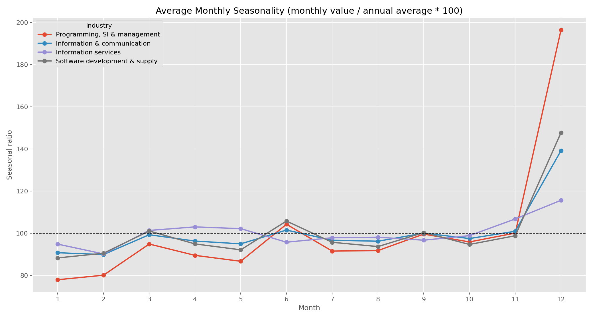
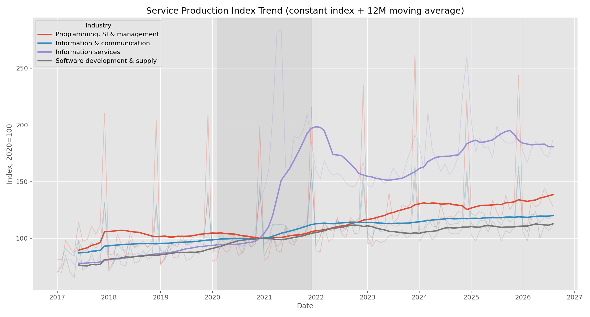
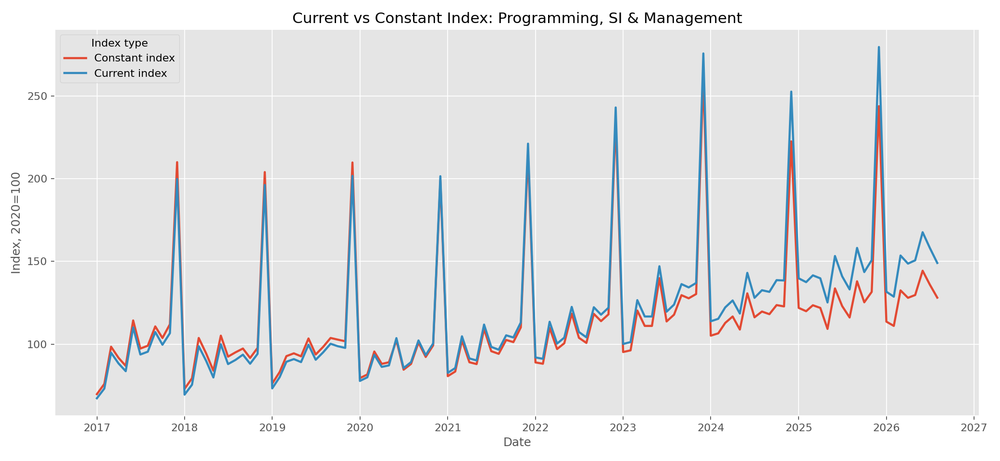
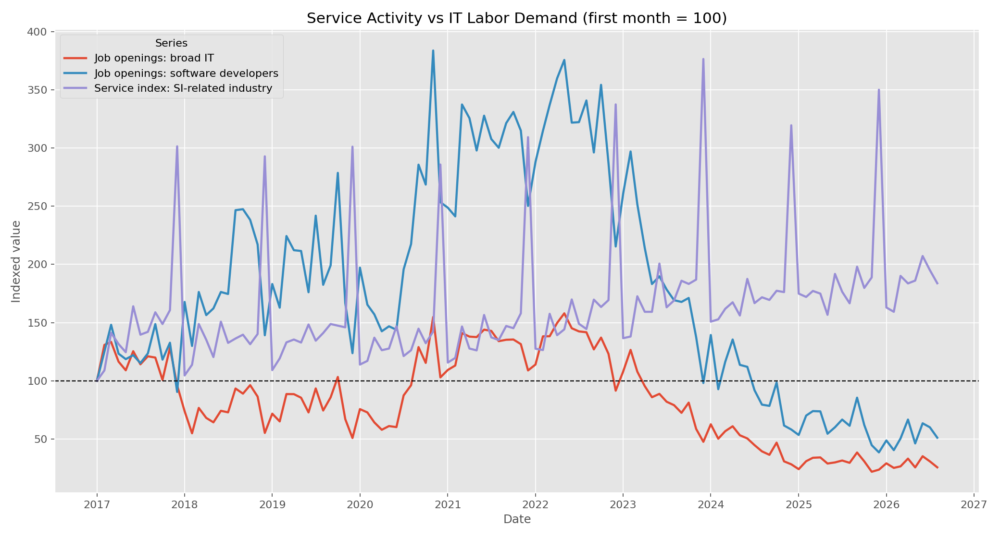
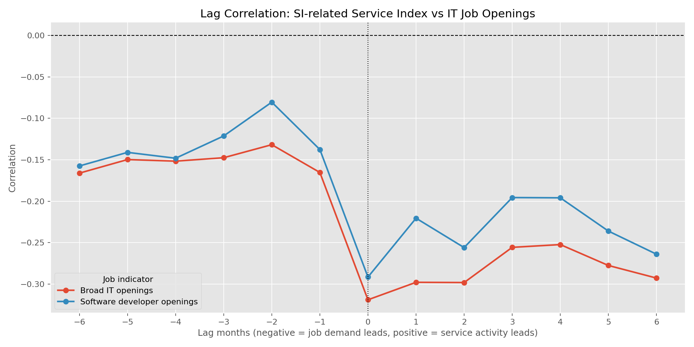
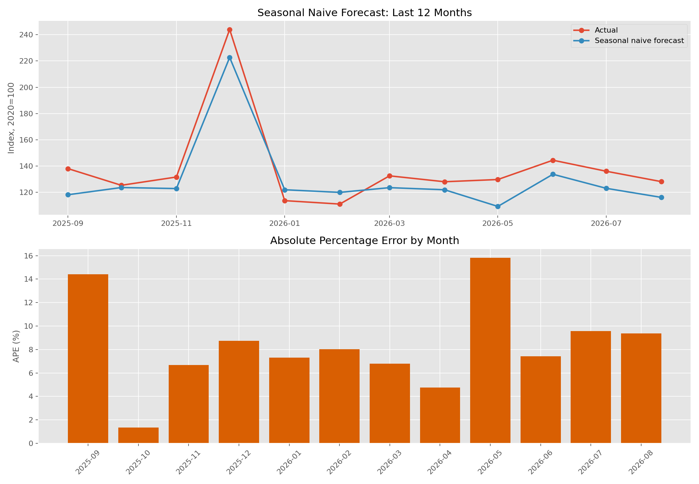

# 한국 IT/SI 업계 시계열 분석 보고서

## 1. 프로젝트 개요

본 프로젝트는 한국 IT/SI 관련 산업의 월별 흐름을 시계열 데이터로 분석한다. 분석의 중심 데이터는 통계청 KOSIS의 서비스업생산지수이며, IT 인력 수요와의 관계를 보기 위해 한국고용정보원 고용행정통계의 직종별 구인구직취업현황을 함께 사용했다.

분석 대상 기간은 두 데이터가 공통으로 확보된 `2017.01 ~ 2026.08`이다.

## 2. 데이터 출처 및 사용 데이터

### 2.1 서비스업생산지수

- 출처: KOSIS / 통계청, 서비스업동향조사 서비스업생산지수
- 기간: 2017.01 ~ 2026.08
- 주기: 월별
- 기준 지표: 불변지수
- 보조 지표: 경상지수, 계절조정지수

분석 업종은 다음 네 개로 제한했다.

| 분석용 이름 | 원본 업종명 |
|---|---|
| information_communication | 정보통신업 |
| software_development_supply | 소프트웨어 개발 및 공급업 |
| computer_programming_system_integration | 컴퓨터 프로그래밍, 시스템 통합 및 관리업 |
| information_service | 정보서비스업 |

본 보고서의 핵심 업종은 SI와 가장 가까운 `컴퓨터 프로그래밍, 시스템 통합 및 관리업`이다.

### 2.2 IT 직종 구인 수요

- 출처: 한국고용정보원 고용행정통계, 직종별 구인구직취업현황(월)
- 기간: 2017.01 ~ 2026.08
- 주기: 월별
- 사용 지표: 구인인원, 구직건수, 취업건수

구인 수요 지표는 두 가지로 구성했다.

| 분석 지표 | 연결 대상 |
|---|---|
| it_broad | 2007직종_정보통신 관련직 전체 / 2018직종_정보통신 연구개발직 및 공학기술직 전체 / 2025직종_정보통신 연구개발직 및 공학기술직 전체 |
| software_developer | 2007직종_소프트웨어개발전문가 / 2018직종_소프트웨어 개발자 / 2025직종_소프트웨어 개발자 |

주의할 점은 직종분류가 2007, 2018, 2025 체계로 변경되었다는 점이다. 본 분석에서는 가장 유사한 직종을 연결했지만, 분류 전환 시점의 변화는 실제 수요 변화와 분류 개정 효과가 섞였을 수 있다.

## 3. 전처리 방식

전처리 스크립트는 `src/preprocess.py`이다.

주요 처리 내용은 다음과 같다.

1. KOSIS 서비스업생산지수 CSV를 `cp949` 인코딩으로 읽었다.
2. 월별 컬럼을 long format으로 변환했다.
3. 기본 분석 지표는 `불변지수`로 설정했다.
4. 고용행정통계 파일은 확장자가 `.xls` 또는 `.xlsx`이나 내부 OOXML 구조를 직접 파싱했다.
5. 2021.09처럼 두 파일에 중복으로 존재하는 월은 값이 같은 경우에만 중복 제거했다.
6. 서비스업생산지수와 구인 수요를 월 단위로 병합했다.

생성된 분석용 파일은 다음과 같다.

| 파일 | 행 수 | 설명 |
|---|---:|---|
| `service_production_long.csv` | 1392 | 4개 업종 × 3개 지수 × 116개월 |
| `job_demand_long.csv` | 232 | 2개 구인지표 × 116개월 |
| `merged_monthly.csv` | 116 | 월별 병합 분석 테이블 |

원본 및 가공 CSV/XLS/XLSX 파일은 라이선스 확인 전까지 Git에 올리지 않도록 `.gitignore`에 등록했다.

## 4. 분석 질문

본 보고서는 다음 다섯 가지 질문에 답한다.

1. IT/SI 관련 서비스업생산지수에 3월 집중 현상이 있는가?
2. 장기 추세는 성장했는가? 코로나19 참고 구간에서 꺾임이 있었는가?
3. 세부 IT 업종별 계절성은 다른가?
4. IT 직종 구인 수요는 SI 관련 생산지수와 같은 방향으로 움직이는가? 선행/후행 관계가 있는가?
5. 전년동월 Seasonal Naive 예측은 어느 시점에서 크게 빗나가는가?

## 5. 분석 결과

### Q1. 3월 집중 현상이 있는가?



`컴퓨터 프로그래밍, 시스템 통합 및 관리업`의 월별 계절비율을 계산했다. 계산식은 다음과 같다.

```text
계절비율 = 월별 값 / 해당 연도 평균 × 100
```

분석 결과는 다음과 같다.

| 항목 | 값 |
|---|---:|
| 3월 평균 계절비율 | 94.92 |
| 3월 외 월 평균 계절비율 | 100.48 |

관찰 결과, 3월 평균 계절비율은 100보다 낮고 3월 외 월 평균보다도 낮았다. 따라서 현재 데이터 기준으로는 `컴퓨터 프로그래밍, 시스템 통합 및 관리업`에서 3월 집중 현상이 있다고 보기 어렵다.

초기 가설은 SI 업계 특성상 3월 또는 연말에 프로젝트 검수·납품이 집중될 가능성이 있다는 것이었으나, 서비스업생산지수 불변지수 기준으로는 3월 집중 가설이 지지되지 않았다.

### Q2. 장기 추세는 성장했는가?



`컴퓨터 프로그래밍, 시스템 통합 및 관리업`의 불변지수는 다음과 같이 변했다.

| 시점 | 값 |
|---|---:|
| 2017-01 | 69.7 |
| 2026-08 | 128.1 |
| 변화율 | +83.8% |

2017년 1월 대비 2026년 8월 값은 약 83.8% 증가했다. 장기적으로는 성장 흐름이 뚜렷하다.

코로나19 참고 구간인 `2020-02 ~ 2021-12`에서 최저값은 다음과 같다.

| 항목 | 값 |
|---|---:|
| 최저 시점 | 2021-01 |
| 최저값 | 80.6 |

다만 이 수치만으로 코로나19가 직접적인 원인이라고 단정할 수는 없다. 본 분석에서는 코로나 구간을 해석 참고 구간으로만 사용했다.

### 경상지수와 불변지수 비교



본 분석의 기본 지표는 가격 변동 영향을 줄인 불변지수이다. 경상지수는 명목 흐름에 가까운 보조 지표로 비교했다. 두 지표의 차이는 가격 요인 또는 명목 효과가 분석 결과에 영향을 줄 수 있음을 보여준다.

### Q3. 업종별 계절성은 다른가?

업종별 계절비율 표준편차는 다음과 같다.

| 업종 | 계절비율 표준편차 |
|---|---:|
| Programming, SI & management | 29.58 |
| Software development & supply | 15.54 |
| Information & communication | 12.19 |
| Information services | 10.79 |

`컴퓨터 프로그래밍, 시스템 통합 및 관리업`의 계절비율 표준편차가 가장 컸다. 이는 SI/시스템 통합 관련 업종의 월별 변동성이 다른 IT 업종보다 클 가능성을 시사한다.

다만 원인까지 확정할 수는 없다. 프로젝트 검수, 공공·민간 발주 주기, 통계 집계 방식 등 여러 요인이 영향을 줄 수 있다.

### Q4. IT 구인 수요는 생산지수와 같은 방향으로 움직이는가?



서로 단위가 다른 생산지수와 구인인원을 비교하기 위해 첫 달을 100으로 지수화했다.

동월 기준 상관계수는 다음과 같다.

| 비교 | 상관계수 |
|---|---:|
| SI 관련 생산지수 vs 상위 IT 직종 구인인원 | -0.319 |
| SI 관련 생산지수 vs 소프트웨어 개발자 구인인원 | -0.292 |

단순 동월 상관계수는 음수였다. 따라서 현재 데이터 기준으로는 생산지수와 구인수요가 같은 방향으로 움직인다고 보기 어렵다.

추가로 ±6개월 시차 상관을 계산했다.



시차 상관의 기준은 다음과 같다.

- 음수 lag: 구인수요가 생산지수보다 선행
- 양수 lag: 생산지수가 구인수요보다 선행

결과는 다음과 같다.

| 지표 | 가장 높은 상관 | 가장 강한 음의 상관 |
|---|---:|---:|
| 상위 IT 직종 구인인원 | lag=-2, corr=-0.132 | lag=0, corr=-0.319 |
| 소프트웨어 개발자 구인인원 | lag=-2, corr=-0.081 | lag=0, corr=-0.292 |

시차를 조정해도 뚜렷한 양의 상관은 나타나지 않았다. 이는 다음 가능성을 시사한다.

1. IT 구인수요는 생산지수보다 경기·채용 정책·분류 개정 등 다른 요인의 영향을 크게 받을 수 있다.
2. 구인인원은 실제 산업 활동 수준보다 선제적 채용 계획 또는 노동시장 상황을 더 반영할 수 있다.
3. 직종분류 개정으로 장기 시계열의 연속성이 약해졌을 수 있다.

따라서 Q4의 결론은 “같은 방향으로 움직인다고 보기 어렵다”이다.

### Q5. Seasonal Naive 예측은 언제 크게 빗나가는가?



전년동월 값을 예측값으로 사용하는 Seasonal Naive 방식으로 예측 오차를 계산했다.

```text
예측값(t) = 실제값(t-12개월)
```

전체 평가 가능 기간에서 절대백분율오차가 큰 달은 다음과 같다.

| 월 | 실제값 | 예측값 | APE |
|---|---:|---:|---:|
| 2024-12 | 222.7 | 262.4 | 17.8% |
| 2026-05 | 129.7 | 109.2 | 15.8% |
| 2023-06 | 139.9 | 118.4 | 15.4% |
| 2018-11 | 97.7 | 112.0 | 14.6% |
| 2023-08 | 117.8 | 100.7 | 14.5% |

최근 12개월 중 오차가 큰 달은 다음과 같다.

| 월 | 실제값 | 예측값 | APE |
|---|---:|---:|---:|
| 2026-05 | 129.7 | 109.2 | 15.8% |
| 2025-09 | 138.0 | 118.1 | 14.4% |
| 2026-07 | 136.0 | 123.0 | 9.6% |

전년동월 값을 그대로 사용하는 방식은 계절성이 안정적일 때 유용하지만, 구조적 변화나 급격한 수준 변화가 있는 달에서는 오차가 커진다.

## 6. 결론

분석 결과를 요약하면 다음과 같다.

1. `컴퓨터 프로그래밍, 시스템 통합 및 관리업`에서 3월 집중 현상은 확인되지 않았다.
2. 장기적으로는 생산지수가 상승했으며, 2017년 1월 대비 2026년 8월 값은 약 83.8% 높다.
3. SI 관련 업종은 비교 대상 IT 업종 중 월별 변동성이 가장 컸다.
4. IT 구인수요와 SI 관련 생산지수는 동월 기준 및 ±6개월 시차 기준 모두 뚜렷한 양의 상관을 보이지 않았다.
5. 전년동월 Seasonal Naive 예측은 일부 달에서 15% 내외의 오차를 보였으며, 구조 변화가 있는 시점에서는 한계가 있다.

## 7. 한계

1. 서비스업생산지수는 매출액이 아니라 산업 활동 수준을 나타내는 지표이다.
2. IT 구인수요 데이터는 직종분류가 2007/2018/2025로 변경되어 완전히 동일 정의의 장기 시계열이 아닐 수 있다.
3. 구인인원과 구직건수로 계산한 비율은 공식 구인배율이 아니다.
4. 코로나19 구간은 참고 구간으로 표시했지만, 인과관계를 증명한 것은 아니다.
5. Seasonal Naive 예측은 단순 기준선 모델이며, 실제 예측 모델로 사용하기에는 한계가 있다.

## 8. AI 사용 로그

AI는 다음 작업에 사용되었다.

- 한국 IT/SI 분석 주제와 데이터 후보 정리
- KOSIS 및 고용행정통계 원본 구조 확인
- 전처리 기준 선택지 정리
- 전처리 스크립트 작성 보조
- 분석/시각화 스크립트 작성 보조
- 결과 수치 요약 및 보고서 초안 작성 보조

상세 내역은 `ai-log.md`에 기록했다.
